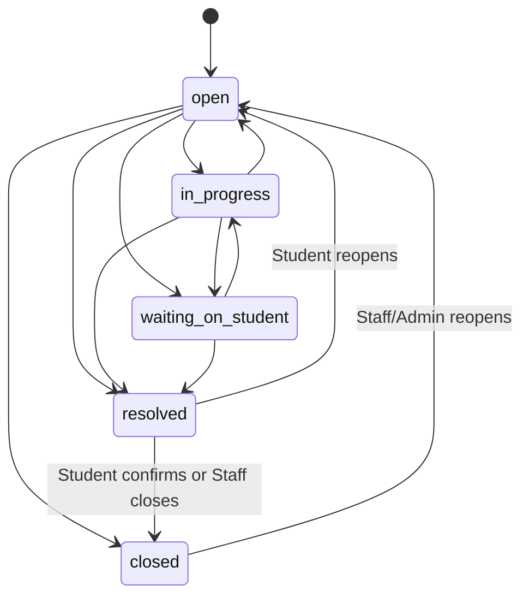

# CampusDesk — Student Ticket Management System

CampusDesk is a full-stack campus helpdesk and issue-tracking platform designed around Role-Based Access Control (RBAC), state-machine ticket workflows, automated department routing, and Service Level Agreement (SLA) tracking.

## Core Capabilities

- **Role-Based Access Control (RBAC)**
  - **Student:** Raise support tickets, track live status and SLA deadlines, post public replies, reopen resolved issues, or confirm closure. Students are strictly isolated to their own tickets and cannot view internal staff notes.
  - **Department Staff:** Manage tickets routed to their assigned department or directly to themselves, transition workflow states, claim tickets, post internal staff-only notes, view department operations analytics, and export filtered CSV reports.
  - **Administrator:** Full cross-department visibility, ticket transfers, user/role provisioning, department routing rule management, editable SLA policies, and campus-wide analytics.
- **Keyword-Based Auto-Routing:** Incoming tickets without an explicit department selection are automatically matched against department keyword rules (`IT Support`, `Hostel & Maintenance`, `Academic & Exams`, `Accounts & Fees`).
- **State-Driven Ticket Lifecycle:** Server-enforced status transitions (`open` -> `in_progress` -> `waiting_on_student` -> `resolved` -> `closed`, with controlled reopen paths).
- **SLA Deadline & Overdue Prioritization:** Resolution targets are computed automatically from priority-tier SLA policies (`urgent`, `high`, `medium`, `low`). Overdue active tickets surface at the top of queues and feed live SLA compliance metrics.
- **Immutable Audit Trail:** Every ticket creation, status change, priority adjustment, department transfer, and assignee update is recorded in `audit_logs` with actor identity and timestamps.

## Tech Stack

- **Frontend:** React 19, TypeScript, Tailwind CSS v4, Vite, Lucide Icons
- **Backend:** Node.js, Express, TypeScript (`tsx`)
- **Database:** SQLite (`node:sqlite` with WAL mode and foreign-key constraints)
- **Security:** `scrypt` password hashing with per-user random salts, `timingSafeEqual` verification, HMAC-SHA256 signed Bearer tokens held in client memory, parameterized SQL queries, and CSV formula-injection neutralization

## Architecture Overview

```text
campusdesk/
├── server.ts                 # Express entrypoint + Vite dev middleware / static serving
├── server/
│   ├── db.ts                 # SQLite schema, indexes, and default department/SLA seeding
│   ├── auth.ts               # scrypt hashing, token signing, requireAuth & requireRole guards
│   └── api.ts                # REST API routes, state machine, SLA math, analytics, CSV export
├── src/
│   ├── App.tsx               # Workspace shell, navigation, and role-scoped routing
│   ├── types.ts              # Shared TypeScript interfaces
│   ├── lib/api.ts            # In-memory Bearer token fetch client and SLA formatting helpers
│   └── components/
│       ├── AuthScreen.tsx          # First-run admin setup, login, and student sign-up
│       ├── TicketListView.tsx      # Filterable ticket table with SLA countdowns
│       ├── TicketDetailView.tsx    # Discussion thread, internal notes, state controls, audit log
│       ├── NewTicketModal.tsx      # Ticket submission with live auto-routing preview
│       ├── AnalyticsView.tsx       # SLA compliance, resolution velocity, department workload
│       └── AdminDirectoryView.tsx  # User provisioning, departments, and SLA policy editor
└── .env.example
```

## Ticket Lifecycle



## Database Schema

- **`users`**: `id`, `full_name`, `email`, `password_hash`, `role` (`student` | `staff` | `admin`), `department_id`, `is_active`, `created_at`
- **`departments`**: `id`, `name`, `description`, `keywords`, `created_at`
- **`sla_policies`**: `priority` (`urgent` | `high` | `medium` | `low`), `response_hours`, `resolution_hours`, `updated_at`
- **`tickets`**: `id`, `ticket_code`, `title`, `description`, `location`, `status`, `priority`, `student_id`, `department_id`, `assigned_to_id`, `sla_due_at`, `resolved_at`, `created_at`, `updated_at`
- **`ticket_comments`**: `id`, `ticket_id`, `author_id`, `body`, `is_internal`, `created_at`
- **`audit_logs`**: `id`, `ticket_id`, `actor_id`, `action`, `old_value`, `new_value`, `created_at`

## Local Setup

1. **Install dependencies:**
   ```bash
   npm install
   ```

2. **Configure environment variables (optional):**
   Copy `.env.example` to `.env` if setting runtime variables. If `JWT_SECRET` is omitted, the server generates an ephemeral cryptographically random signing key in memory on startup.

3. **Start the development server:**
   ```bash
   npm run dev
   ```
   The application runs on `http://localhost:3000`.

4. **First-run workspace initialization:**
   Open `http://localhost:3000` in your browser. When no administrator exists in the database yet, the setup screen prompts you to create the primary administrator account (and optionally seed sample departments, staff, student accounts, and tickets). Once claimed, the bootstrap endpoint locks permanently.

5. **Production build and run:**
   ```bash
   npm run build
   NODE_ENV=production npm start
   ```

## Design Decisions

- **Public registration scoped to students only:** `POST /api/auth/register` hardcodes `role = 'student'` server-side so self-registered users can never escalate privileges. Staff and administrator accounts can only be provisioned by an existing administrator.
- **Dual-visibility comment threads:** Instead of maintaining a separate table for staff notes, `ticket_comments` uses an `is_internal` flag enforced at the SQL query boundary (`AND is_internal = 0` for students) and strips the internal note composer from student views.
- **In-memory session tokens:** Authentication tokens are kept in JavaScript memory rather than `localStorage` to avoid persistent token exposure to client-side scripts.
- **Transactional ticket updates with audit logging:** Status transitions, priority recalculations, department transfers, and assignee changes commit atomically alongside their `audit_logs` records inside SQLite `BEGIN IMMEDIATE` transactions.
